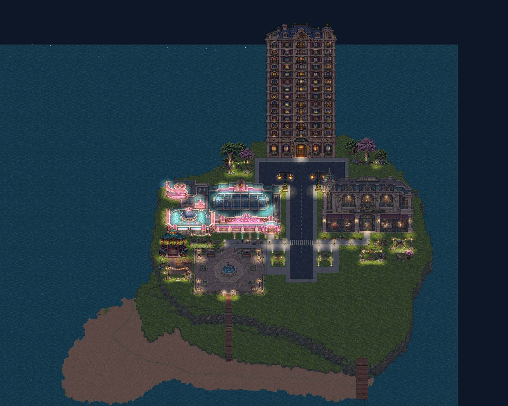
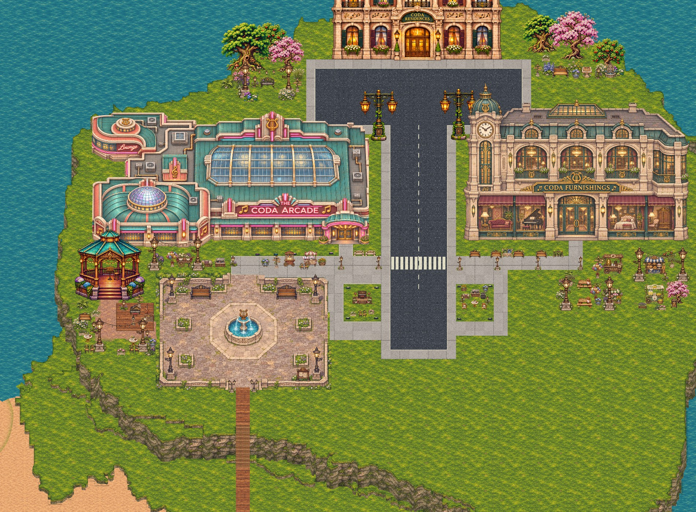
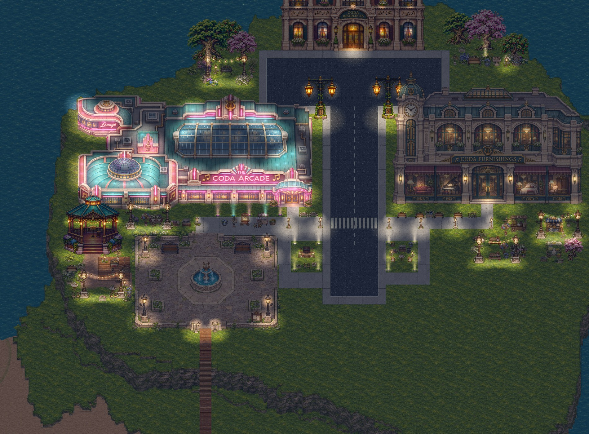

# Coda Town festival map

[Download and preview the map](../town/maps/) · [Festival project JSON](../town/maps/coda-town-festival.json) · [Town Builder](../town/builder/?kit=urban&v=festival-town-1)

The uploaded town has over 100 individually movable additions: a gazebo music garden, arcade record corner, café and market pockets, festival lighting, and asymmetric gardens framing the apartment approach. The original 43 objects, terrain, roads, levels and spawn remain unchanged. The beach and southeast area remain clear.

## Open and edit

1. In Town Builder, choose **Save project** to back up your current map.
2. Download **coda-town-festival.json** from the map page.
3. Choose **Open** in Town Builder and select the downloaded JSON.
4. Use **Select / move** to reposition individual decorations. The light strings and music-garden deck are movable assets too.
5. Choose **Walk test** to explore, or **Play this town** to visit the saved project. Use **Save project** to download your edited version.

The **City night / Daylight** button changes the lighting view; **NPCs on / off** controls walking NPCs while editing. Undo and Redo work for decoration moves.

## Previews

These captures use the town’s shared renderer and placed assets. The JSON stores ordinary independent project objects, so it remains editable through the existing builder tools.

## Validation

- The final project contains 151 objects: the original 43 and 108 additions. Source terrain, edges, spawn and original objects are preserved exactly; beach and southeast exclusions pass.
- Production collision checks report zero errors or overlaps. All seven existing entrances remain reachable and pass walking checks. The related Node suite passes 197 tests.
- Browser checks opened the project, dragged a festival string and a bench, and verified exact Undo/Redo, autosave reload and portable JSON export. No browser errors occurred.
- The download page passes at 1440-pixel desktop and 390-pixel mobile widths, with all three previews loaded, no horizontal overflow, a keyboard-accessible download, and an exact JSON download. Its download button fetches the project and saves a JSON file directly.
