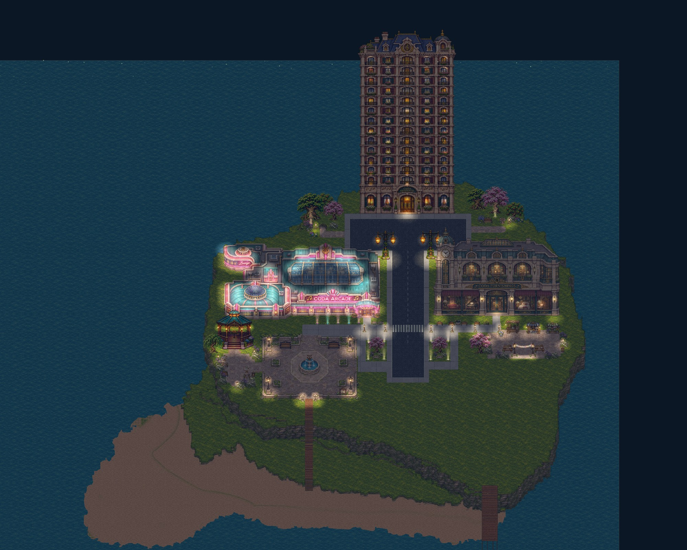
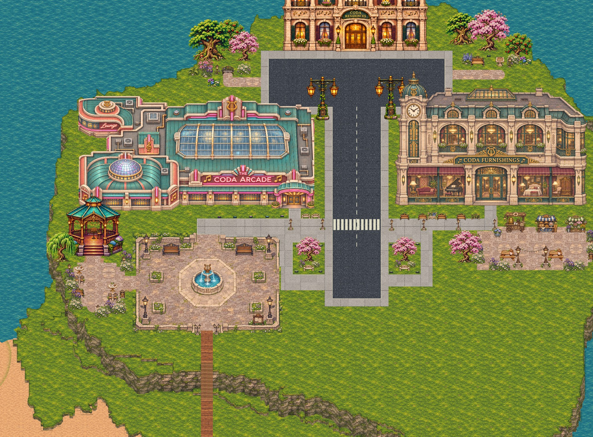
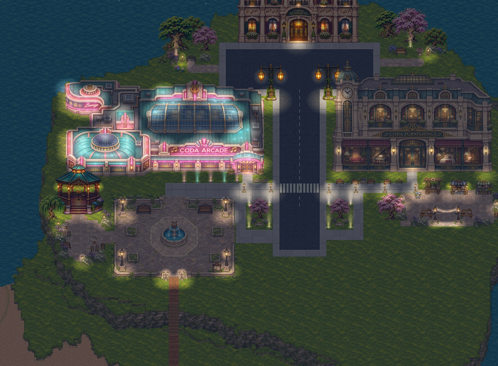

# Coda Town · Courtyards and gardens

[Download and preview the map](../town/maps/) · [Courtyard project JSON](../town/maps/coda-town-courtyards.json) · [Town Builder](../town/builder/?kit=urban&v=courtyard-walk-1)

The town now has a connected market court beside the furniture store, a shared forecourt around the gazebo, and quiet gardens near the residences. The market's stalls face a common aisle with picnic tables beyond it. The gazebo remains the main performance space, with café seating beside its approach. Matching paving and repeated planting connect these spaces.

The original 43 objects, roads, terrain heights, water, edges and spawn remain in place. Dry land receives new paving and soft ground transitions; the beach and southeast area remain clear. Decorations are separate movable objects, and the ground finishes remain editable with the builder's painting tools.

## Open and edit

1. In Town Builder, choose **Save project** to back up your current map.
2. Download **coda-town-courtyards.json** from the map page.
3. Choose **Open** in Town Builder and select the downloaded JSON.
4. Use **Select / move** to reposition individual decorations, or the ground painting tools to adjust paving and planted edges.
5. Choose **Walk test** to explore, or **Play this town** to visit the saved project. Use **Save project** to download your edited version.

The **City night / Daylight** button changes the lighting view; **NPCs on / off** controls walking NPCs while editing. Undo and Redo work for decoration moves and ground painting.

The [earlier festival draft](../town/maps/coda-town-festival.json) remains available as a separate project file.

## Previews

These captures use the town's shared renderer and placed assets. The project stores ordinary independent decorations and editable ground cells.

## Validation

- The project contains 112 objects: the original 43 and 69 individually movable additions.
- New paving and blended edges change 599 dry-ground finish cells. Nineteen obsolete material-edge curves were removed to clear old dirt seams; elevation contours and actual ground heights remain unchanged.
- Original objects, spawn, edges, concrete, water, beach and southeast are preserved. Production checks report zero collision overlaps or errors, and all seven entrance routes pass walking checks with their original paths.
- Browser checks moved a table and festoon independently and verified Undo/Redo, reload and exact export. Desktop and mobile previews load correctly; the download button saves the exact project as `coda-town-courtyards.json`.
