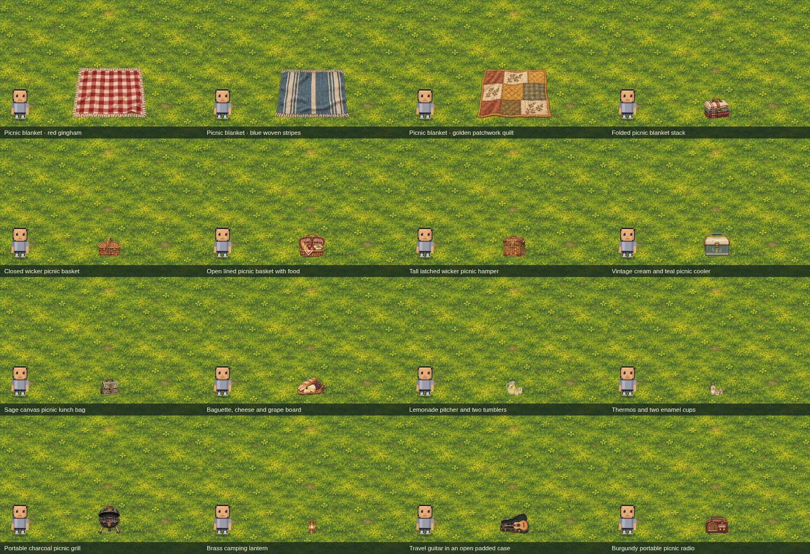
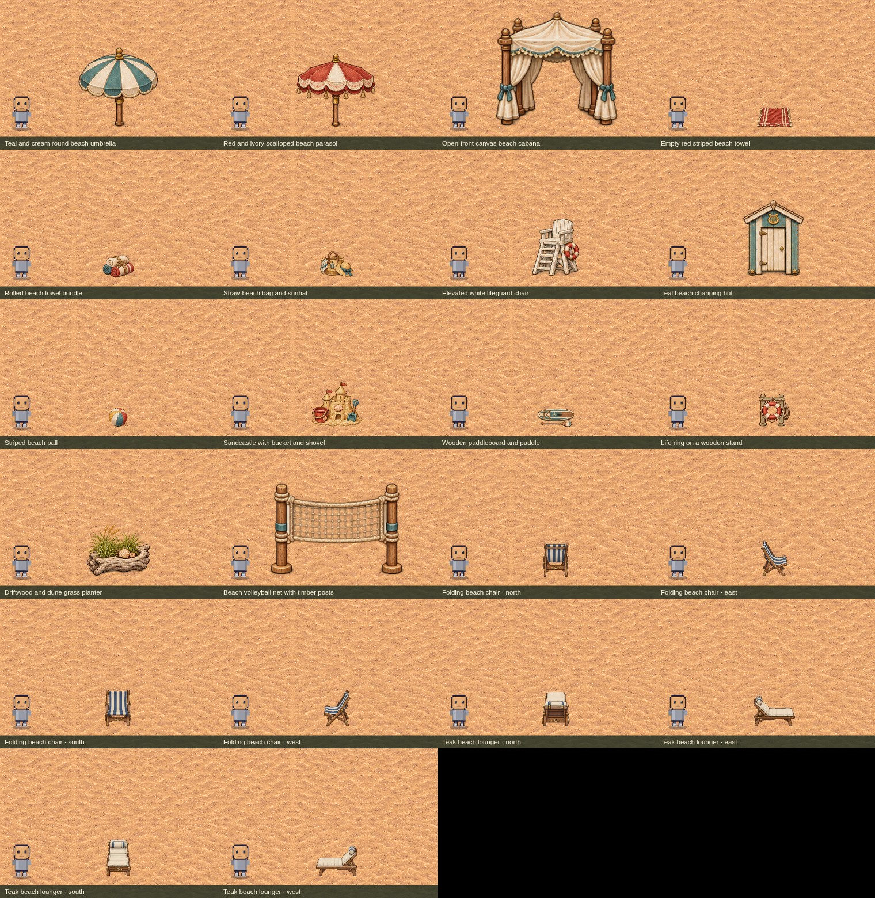
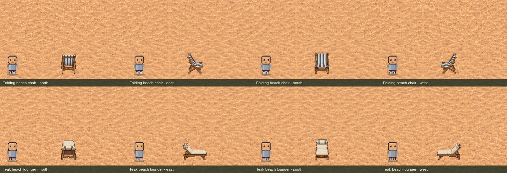

# Coda Town picnic and beach assets

[Open the Picnic & beach library](../town/builder/?kit=leisure&v=furniture-facings-1), or choose **Picnic & beach** beside Urban kit in Town Builder. The collection contains 38 separate, movable assets. Opening the collection keeps your current project.

Picnic items include three spread blankets, folded blankets, closed and open baskets, a wicker hamper, cooler, lunch bag, food board, lemonade, thermos and cups, grill, camping lantern, travel guitar and picnic radio. Beach items include umbrellas, a cabana, towels, beach bag, lifeguard chair, changing hut, ball, sandcastle, paddleboard, life ring, dune planter and volleyball net.

Both the folding beach chair and teak sunlounger have north, east, south and west artwork. Choose the facing in the library; selection starts that view at zero rotation. All eight views use a consistent physical scale.

Spread blankets, towels and the paddleboard use the ground layer and remain walkable. Baskets and furniture have collision around their feet. The cabana leaves its middle open, and the camping lantern casts warm light at night. Size, layer and collision remain editable in the inspector. Existing asset-pack exports include the new artwork and facing metadata.

The uploaded project and existing maps are unchanged. The screenshots below are asset review fixtures using the shared game renderer, with the player beside the props for scale.

The five collection definition checks and browser regression cover discovery, authored directions, collision, source resolution, placement, movement, Undo/Redo, browser reload, portable export and Play parity. Browser checks also verify that changing library filters leaves the loaded project intact.
