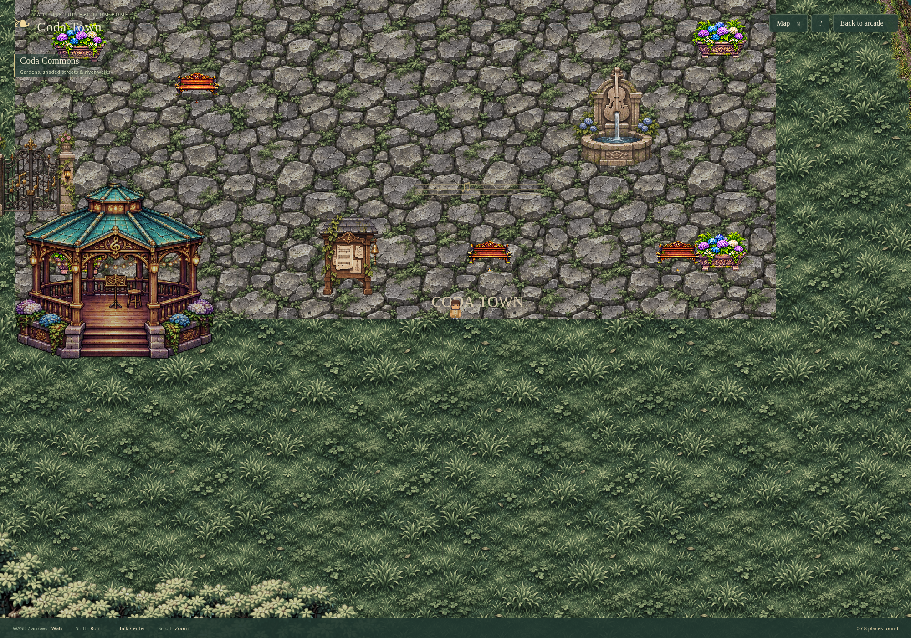
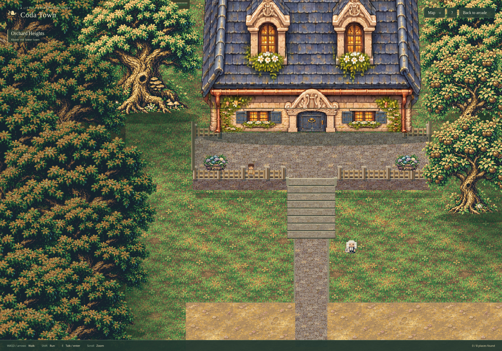
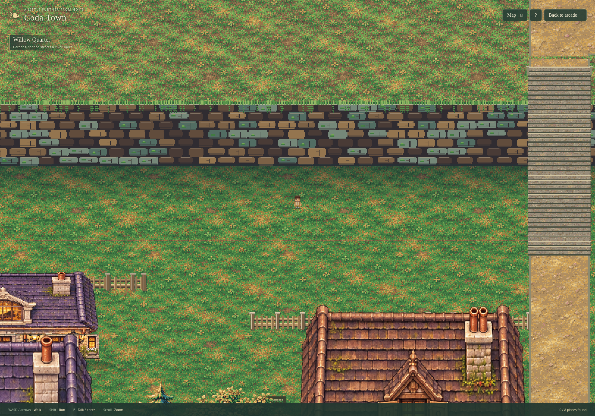
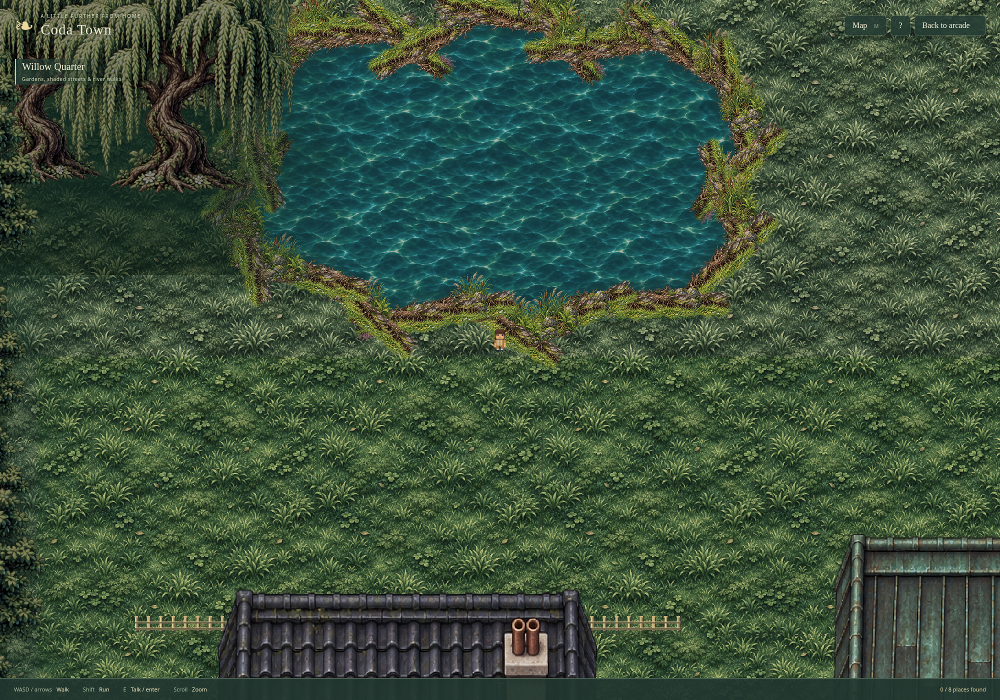
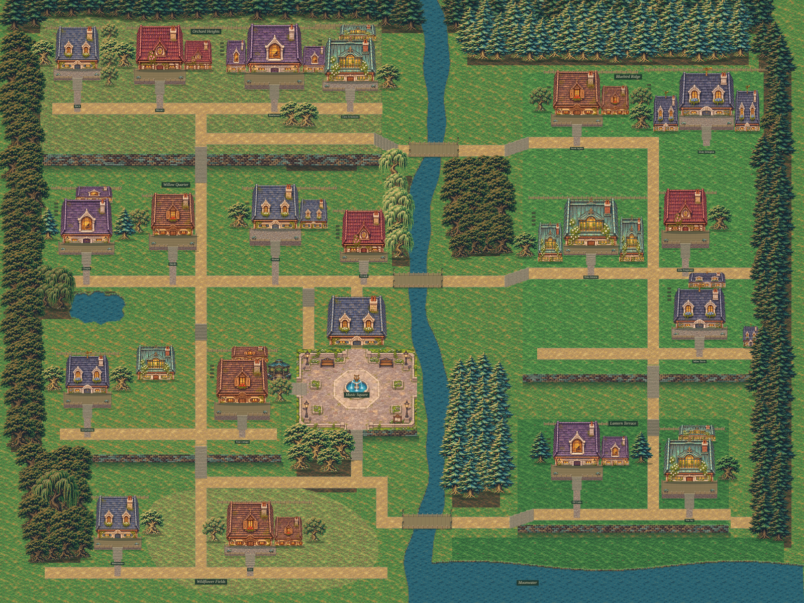
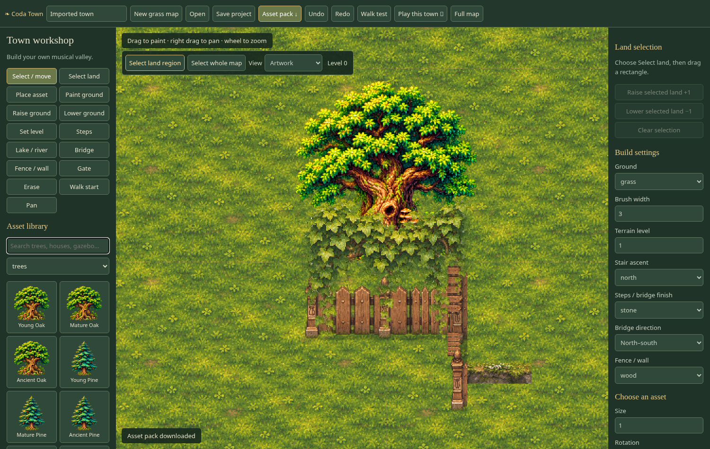
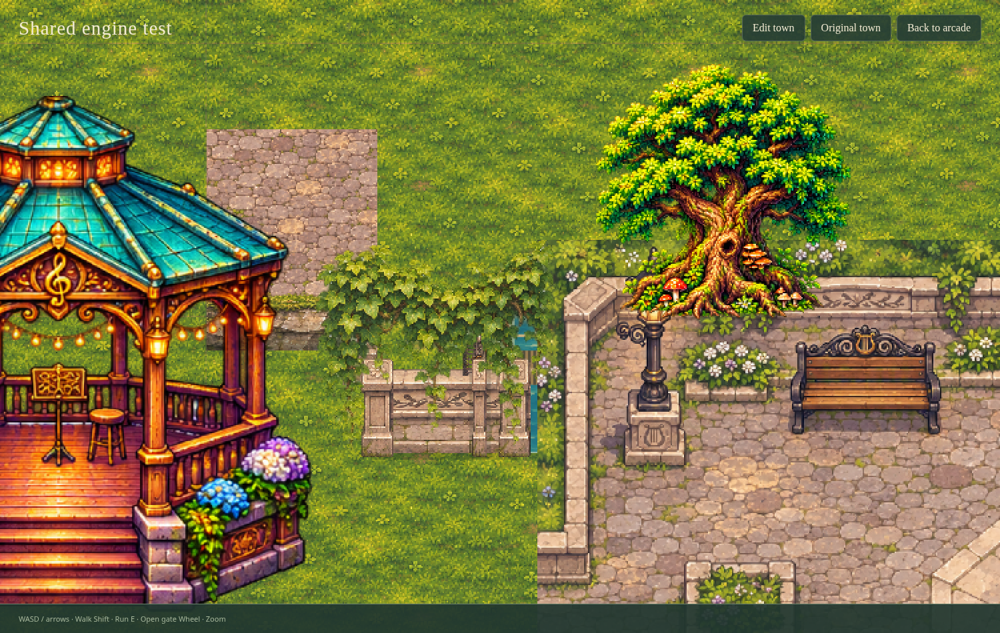
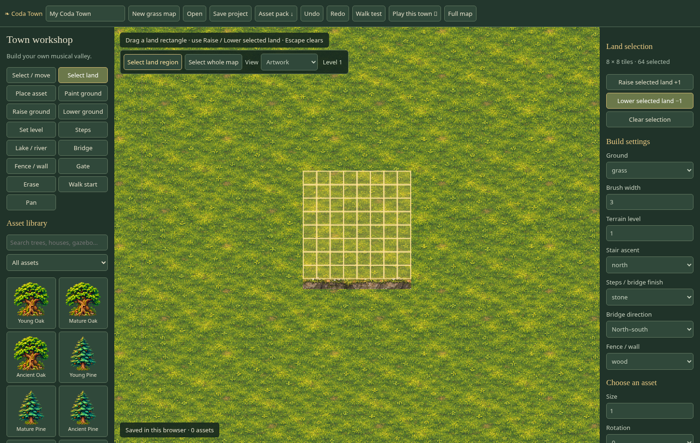

# Coda Town — playable art direction

These are captures from the running game. Music Square uses the approved
European musical piazza artwork, with a centered fountain, collision, live
musicians and working terrace entrances. Houses and ground materials have
been redrawn against that visual benchmark.

## Music Square

The whole square is framed so the fountain's center and the perimeter layout
are visible. The bandstand is outside the square rather than obstructing it.

## Fence scale

A character stands beside the enlarged porch railing. Property fences have
substantial posts and complete bays; porch railings use their own height.

## Cliff height

Main cliffs are 240 and 160 world pixels high, with physical stair connections.
The civic terrace is 128 pixels high. The renderer uses connected terrain tiles.

## Lake bank

Connected terrain edges share the water collision boundary. The repeated,
rotated fringe images have been removed.

## Whole town

## House and interior

[House and porch](house.png) · [Matching interior](interior.png)

The approved square is the benchmark for subsequent visual work. Movement
checks verify functionality; they do not establish that every part of the town
has reached the same artistic quality.

## Town Builder

The builder starts with grass only and preserves the approved Music Square as a placeable scene. Includes connected fences/walls, multiple trees and house footprints, terrain, stairs, water, bridges, collision walk testing and portable project/asset downloads.

### Playable authored maps

**Play this town** saves the editor map and opens it in the actual town route. The builder and authored-map gameplay now share their renderer, assets, pixel resolution and collision/movement rules. Static scene pixel parity is checked in the browser tests. The original handcrafted town remains available separately.

### Land region selection

Choose **Select land**, drag a rectangle, then **Raise selected land +1** or **Lower selected land −1**. Each action is undoable; Clear selection or Escape removes the highlight.

## Detailed estates, terraces and elevation tools

Actual browser captures of the updated shared game artwork:

- [Full home-and-yard asset library — 19 properties](home-estates-library.png)
- [Your home and garden at placement scale](home-estate.png)
- [Detailed connected walls, stair flights, foliage and cliff faces](terraces-detail.png)
- [Numbered elevation plan and large-area selection](elevation-plan.png)

Open the **home estates** category to place whole properties. Use the canvas toolbar for **Select land region**, **Select whole map**, **Height colors**, or **Elevation plan**. Music Square and water retain their existing artwork.
